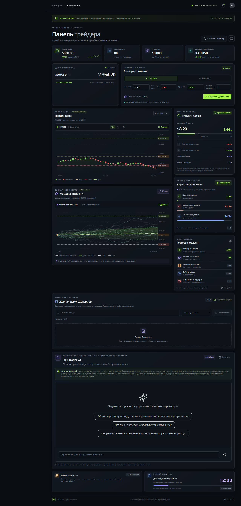
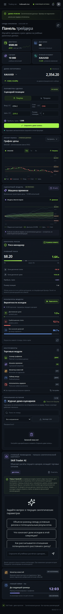

# Skill Trader — демо-панель

Русскоязычный интерактивный прототип Skill Trader: синтетические котировки и свечи, редактируемые уровни позиции, панель риска, «Машина времени» с 10 000 учебными сценариями Монте-Карло, локальный журнал и Skill Trader AI для объяснения текущего демо-сценария.

> **Только учебное демо.** Цены и OHLC-свечи синтетические, результаты модели не являются прогнозом или рекомендацией. Приложение не подключено к брокеру и не отправляет реальные ордера. Сохранённый сценарий — запись параметров для анализа, а не исполненная сделка.

## Skill Trader AI

Skill Trader AI — собственный русскоязычный интерфейс и набор правил приложения поверх проектной модели `gpt-6-luna`; это не обучение или fine-tuning базовой модели. Ассистент объясняет арифметику и результаты только текущего синтетического сценария, не выдаёт сигналов покупки/продажи и не подключается к live-котировкам или брокеру. Сервер проверяет подпись и project ID сессии; для чата используется Manus OAuth/сессия, а база данных остаётся выключенной.

До отправки интерфейс сообщает, что по явному действию пользователя на сервер уходят вопрос, до восьми предыдущих реплик и ограниченный набор параметров текущего синтетического сценария. Журнал, демо-баланс, настройки и данные `localStorage` не передаются. История чата остаётся в памяти вкладки и очищается при изменении параметров/результатов сценария, чтобы не смешивать разные расчёты. Вызовы расходуют кредиты проекта; ответы не являются финансовой рекомендацией. Встроенный серверный лимит — до 6 запросов в минуту и 80 в UTC-день на пользователя; он работает в памяти экземпляра приложения и подходит для закрытого прототипа, но не заменяет распределённый лимит для публичного сервиса. Повтор выполняется вручную только для временных/ограничивающих ошибок; постоянный отказ модели требует исправить параметры или конфигурацию. Подробности в [заметке о модели и источнике каталога](docs/trader-ai-model-notes.md).

## Демонстрация

**Desktop:**



**Mobile:**



## Возможности

На панели доступны демонстрационные XAUUSD, EURUSD и BTCUSD, направление позиции, вход, стоп, цель и размер. Для учебной прозрачности объём подписан в единицах инструмента: XAUUSD — oz (старт 1), EURUSD — EUR (старт 1 000), BTCUSD — BTC (старт 0,01). При выборе инструмента автоматически устанавливается его демонстрационный размер; риск и потенциал считаются как расстояние цены × объём. Эти значения не соответствуют спецификациям какого-либо брокера. При переключении 15м/1ч/4ч график строит отдельные синтетические OHLC-свечи: временные метки следуют выбранному интервалу, последняя свеча выравнивается по границе UTC, а масштаб волатильности — по квадратному корню длительности интервала. График и веер сценариев связаны с параметрами позиции; модель показывает 28 выборочных траекторий, медиану и диапазон 20–80% общей симуляции.

Текущий черновик автоматически сохраняет инструмент, направление, уровни, размер позиции и период графика в `localStorage` этого браузера и восстанавливается после перезагрузки. Повреждённые или неизвестные значения заменяются безопасным демо-набором по умолчанию; никаких пользовательских ключей, брокерских данных или других сведений черновик не содержит.

Кнопка сохранения записывает выбранный инструмент, время, направление, уровни, размер с единицей инструмента и оценку риска/потенциала в журнал. До 50 записей хранятся в `localStorage` этого браузера; их можно удалять по одной. Журнал ищет по тикеру и фильтрует по направлению. CSV экспортирует текущую выборку вместе с единицей размера в UTF-8 с BOM и разделителем `;`; формульные текстовые значения обезвреживаются. Файл скачивается локально, без передачи данных на сервер.

Кнопка «Настройки» открывает окно управления **только демонстрационным** балансом ($1–$1 000 000 000) и максимальным риском на сценарий (0,1–10%). По умолчанию используются $500 и лимит 2%. Сводный баланс и индикатор риск-менеджера обновляются при сохранении; значения остаются в `localStorage` браузера, не связаны с реальным капиталом или брокером.

График и учебный таймер используют общий период: 15м, 1ч или 4ч. Таймер показывает время до следующей границы интервала и обновляется раз в секунду; он не анализирует свечи и не формирует сигналы. Монитор новостей обозначен как отключённый, поскольку внешний источник не подключён. Панель адаптирована для мобильного экрана и desktop.

## Skill Trader AI

Учебный помощник использует server-side модель `gpt-6-luna` и отвечает только об ограниченном синтетическом сценарии, не выдавая торговых сигналов или персональных финансовых советов. После явного нажатия «Отправить» передаются текущие уровни/параметры, доли исходов и до 8 реплик; вопрос ограничен 1 200 символами, ответ — 700 completion tokens и 5 000 символами. В журнал, настройки счёта и `localStorage` запрос не заглядывает; текст вопроса и диалога покидает браузер для обработки моделью и расходует project credits. История хранится только в памяти вкладки.

При изменении параметров старые вероятности скрываются, чат ждёт завершения соответствующего пересчёта, затем история сценария сбрасывается. Серверный вызов модели имеет общий дедлайн 45 секунд; временные сетевые ошибки повторяются ограниченно, а отсутствующая конфигурация не тратит пользовательскую квоту повторными попытками. Лимиты — 6 запросов в минуту и 80 в UTC-день на пользователя.

## Запуск

Требуется Node.js и pnpm, зафиксированный lock-файлом.

```bash
pnpm install
pnpm dev
```

Откройте `http://localhost:3000`. `pnpm dev` запускает React/Vite вместе с Express/tRPC backend; проектная среда предоставляет server-side доступ к модели. База данных для прототипа не включена. `pnpm dev:static` запускает только интерфейс, поэтому AI endpoint там недоступен.

## Проверки

```bash
pnpm check
pnpm test
pnpm build
```

Проверки охватывают синтетическую симуляцию и свежесть её входов, локальный журнал и настройки, безопасный CSV, AI-контекст и лимиты/таймауты, обработку ошибок конфигурации, session auth без БД и GPT max-token forwarding. Тесты не вызывают платную модель.

## Структура

- `client/src/pages/Home.tsx` — панель, состояние сценария/периода, настройки демо-счёта и локальный журнал.
- `client/src/components/trader/PriceChart.tsx` и `ScenarioChart.tsx` — синтетические свечи и веер сценариев.
- `client/src/components/trader/RiskPanel.tsx` — динамический расчёт и визуализация лимита риска.
- `client/src/components/trader/AccountSettingsModal.tsx` — форма демо-баланса и максимального риска.
- `client/src/components/trader/DemoJournal.tsx` — поиск, фильтрация и CSV-действие.
- `client/src/components/trader/CandleTimer.tsx` — учебный таймер выбранного периода.
- `client/src/components/trader/TraderAIChat.tsx` и `client/src/components/AIChatBox.tsx` — локальная история и русскоязычный AI-интерфейс.
- `client/src/lib/demoScenarioDraft.ts`, `demoAccountSettings.ts`, `demoInstruments.ts`, `demoJournal.ts`, `simulation.ts`, `candleTimer.ts` — восстановление черновика, локальные настройки, учебные единицы, журнал/CSV, модель и таймер.
- `shared/traderAssistant.ts`, `server/traderAssistant.ts`, `server/routers.ts` — строгая схема запроса, system policy, сценарный контекст, in-memory лимиты и защищённый tRPC endpoint.
- `server/demo-scenario-draft.test.ts`, `demo-account-settings.test.ts`, `demo-instruments.test.ts`, `demo-journal.test.ts`, `demo-journal-download.test.ts`, `trader-simulation.test.ts`, `candle-timer.test.ts` — тесты localStorage, единиц размера, CSV, симуляции и интервалов.
- `server/trader-assistant.test.ts`, `server/platform.test.ts` — тесты ограничений AI, auth без БД и request shape.
- `client/public/manus-routes.json` и `skilltrader-mark.svg` — route manifest и favicon.
- `docs/demo/desktop.png`, `docs/demo/mobile.png` — полноразмерная визуальная демонстрация.
- `plan.md`, `TODO.md` — план и статус работ.

## Возможные подключения

Live-источники котировок, внешние новости, paper-trading и брокерские ордера здесь не подключены. Их нельзя считать частью текущего демо; добавление потребует отдельного решения, проверки лицензий, серверной защиты и безопасного хранения секретов. Не помещайте секреты в клиентский код или GitHub.

Лицензия проекта: MIT.
